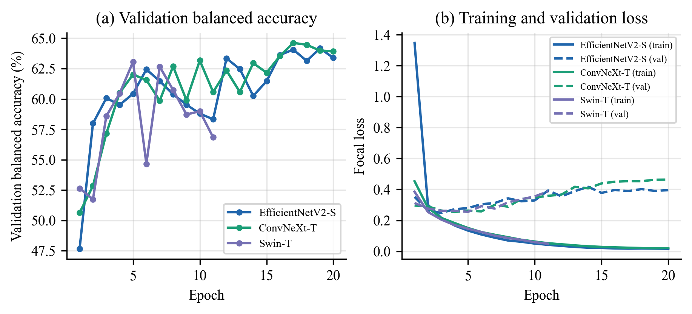
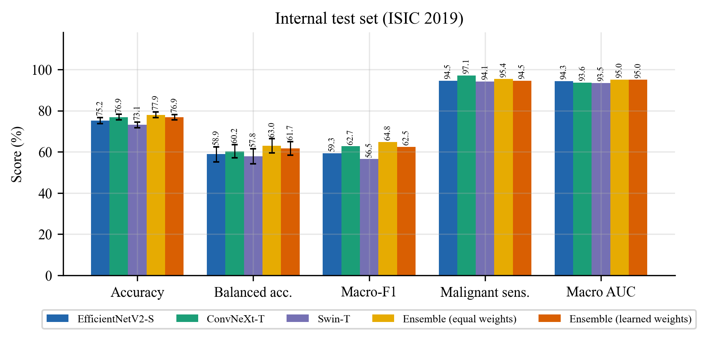
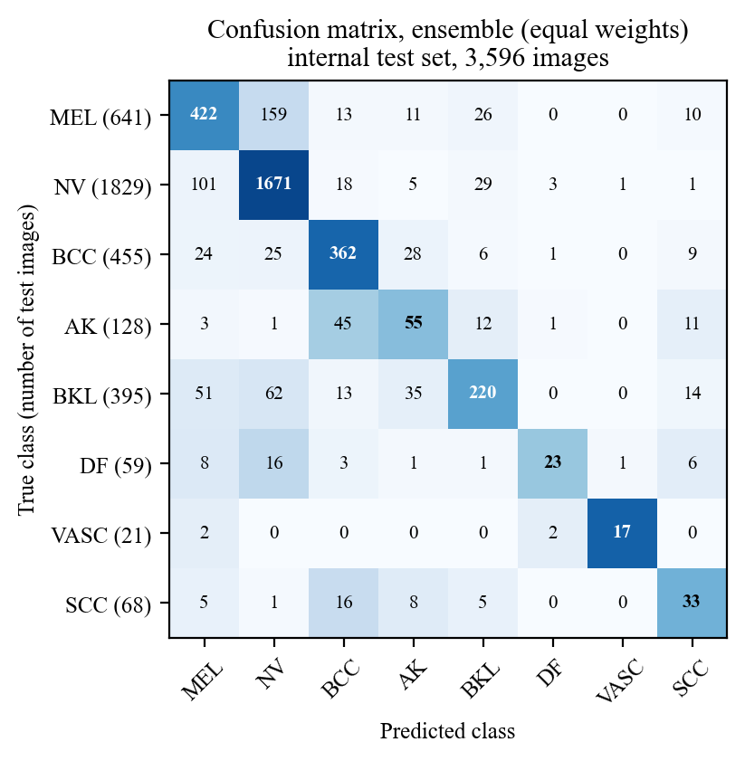

# Skin Cancer Detection Using Deep Learning

**A Comparative Analysis and a Multi-Model CNN–Transformer Ensemble with External Validation**

Abhishek Patil, Jay Tripathi, Paras Shinkar, Salman Sheikh
With the guidance of Dr. Bhakti Sonavane
Department of Computer Engineering, Shah & Anchor Kutchhi Engineering College (Autonomous, Affiliated to University of Mumbai), Mumbai, Maharashtra, India

---

## What this project does

We classify dermoscopic skin-lesion images into 8 classes (melanoma, nevus, basal cell carcinoma, actinic keratosis, benign keratosis, dermatofibroma, vascular lesion, squamous cell carcinoma).

- **3 algorithms:**
  - EfficientNetV2-S (CNN)
  - ConvNeXt-T (CNN)
  - Swin-T (Vision Transformer)
- **Our USP:** the three models are combined by soft voting into one ensemble. The ensemble beats every single model on every main metric.
- **2 datasets:**
  - **ISIC 2019** (25,331 images): used for training, validation and the internal test.
  - **PAD-UFES-20** (2,298 smartphone images, Brazil): used only as an external test the models never saw.

## Results (measured, RTX 3060 Laptop GPU, 16–17 Oct 2026)

| System | Internal accuracy | Balanced accuracy | Macro-AUC | External accuracy | External malignant AUC |
|---|---|---|---|---|---|
| EfficientNetV2-S | 75.19% | 58.88% | 0.943 | 33.68% | 0.833 |
| ConvNeXt-T | 76.89% | 60.21% | 0.936 | 34.73% | 0.844 |
| Swin-T | 73.08% | 57.80% | 0.935 | 35.34% | 0.844 |
| **Ensemble (all 3)** | **77.95%** | **62.99%** | **0.950** | **37.25%** | **0.873** |

At the referral threshold, the ensemble detects **95.4% of malignant lesions** on the internal test set.





## Repository layout

```
paper/                         IEEE paper and team / teacher reports
  sc_two_column.pdf              the paper (IEEE two-column)
  sc_one_column.pdf              same paper, one-column
  Training_Results_Report.pdf    all measured results with graphs
  Training_and_Evaluation_Explained.pdf  how we trained + how accuracy/precision/confusion matrix are calculated
  Reference_Links.pdf            all 71 references with links
  Datasets_Report*.pdf, Algorithms_Report*.pdf, Project_Flow.pdf, Paper_Explained_Simple.pdf
  *.tex, references.bib, figures/   LaTeX sources

training/                      code, training data splits, logs and results
  prepare_data.py                download, resize, de-duplicate, lesion-grouped split
  train.py                       train one model
  ensemble_eval.py               combine the 3 models + all metrics
  make_figures.py                graphs + LaTeX tables for the paper
  make_evaluation_examples.py    confusion matrices, precision, example images
  data/                          train / val / test / external split files (every image + label)
  runs/<model>/                  history.csv (per-epoch curves), best.pt (trained weights, Git LFS), logits, logs
  results/                       metrics.json, ablation, skin-type breakdown, all figures
```

## Training data

The image lists for every split are in [`training/data/`](training/data/). See [`training/data/README.md`](training/data/README.md).

| Split | Images | Source |
|---|---|---|
| Train | 18,076 | ISIC 2019 |
| Validation | 3,659 | ISIC 2019 |
| Internal test | 3,596 | ISIC 2019 |
| External test | 2,298 | PAD-UFES-20 |

The images themselves belong to the dataset owners and are not stored here. Download them from the official links below; `prepare_data.py` then rebuilds exactly the same splits.

- ISIC 2019: https://challenge.isic-archive.com/data/#2019
- PAD-UFES-20: https://data.mendeley.com/datasets/zr7vgbcyr2/1

## How to reproduce

```powershell
cd training
pip install -r requirements.txt
python prepare_data.py
python train.py --model effnetv2_s
python train.py --model convnext_t
python train.py --model swin_t
python ensemble_eval.py
python make_figures.py
```

To use the trained weights without retraining, install [Git LFS](https://git-lfs.com) before cloning so that `training/runs/*/best.pt` downloads.

More detail: [`training/README.md`](training/README.md) and [`paper/README.md`](paper/README.md).
